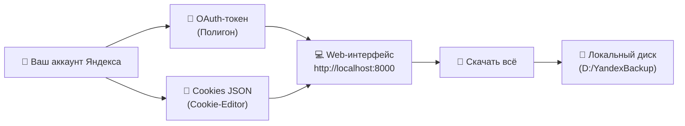

# 🔑 Полное иллюстрированное руководство: Получение токена и кук для Yandex.Disk Backup
### (Понятно и доступно каждому — даже если вы впервые запускаете подобную программу)

[](https://github.com/PXSYS13/yadisk_backup)
[](https://github.com/PXSYS13/yadisk_backup)
[](https://t.me/davronsv)
[](https://www.youtube.com/watch?v=XAiJxqHkEUA)
[](https://www.donationalerts.com/r/davronsvv)

---

## 📑 Содержание

1. [Введение: Чем отличается токен от кук?](#-введение-чем-отличается-токен-от-кук)
2. [Общая схема работы](#-общая-схема-работы)
3. [Часть 1. Получение OAuth-токена (для обычных файлов)](#-часть-1-получение-oauth-токена-для-обычных-файлов-и-папок)
4. [Часть 2. Получение Cookies (для безлимитных фото Photoslice)](#-часть-2-получение-cookies-для-безлимитных-фото-photoslice)
5. [Часть 3. Запуск скачивания в 1 клик](#-часть-3-запуск-скачивания-в-1-клик)
6. [Часть 4. Справочник ошибок (502, 504, 429 и серверные сбои)](#-часть-4-справочник-ошибок-серверов-яндекса-502-429-и-др)
7. [Поддержка и сообщество](#-поддержка-и-сообщество)

---

## 💡 Введение: Чем отличается токен от кук?

| Параметр | 🔑 OAuth-токен | 🍪 Cookies браузера |
|---|---|---|
| **Для чего нужен?** | Скачивание **обычных файлов и папок** | Скачивание **скрытого безлимита с телефона** (Photoslice) |
| **Как работает?** | Официальный REST API Яндекс.Диска | Эмуляция веб-кабинета пользователя |
| **Где берётся?** | В 1 клик на странице Полигона Яндекса | Через бесплатное расширение Cookie-Editor |
| **Срок жизни** | Около 1 года | От нескольких дней до недель |
| **Безопасность** | 100% безопасно, хранится только у вас в `.env` | Хранится только локально в `cookies.json` |

> [!NOTE]
> Логин и пароль от вашей почты вводить в программу **не требуется**! Токен и куки — это безопасные временные ключи авторизации.

---

## 🔄 Общая схема работы



---

## 🔑 Часть 1. Получение OAuth-токена (для обычных файлов и папок)

Токен нужен для работы с файлами на основном диске. Процесс занимает ровно 1 минуту.

### 🔹 Шаг 1. Проверьте ваш аккаунт
1. Откройте любой удобный браузер (*Яндекс.Браузер, Google Chrome, Opera, Microsoft Edge или Firefox*).
2. Перейдите на сайт [disk.yandex.ru](https://disk.yandex.ru).
3. Посмотрите в правый верхний угол страницы: убедитесь, что вы залогинены именно в **тот аккаунт**, с которого нужно спасти файлы.

### 🔹 Шаг 2. Откройте официальный «Полигон»
1. Откройте новую вкладку в браузере.
2. Вставьте в адресную строку ссылку:  
   👉 **[https://yandex.ru/dev/disk/poligon/](https://yandex.ru/dev/disk/poligon/)**  
   и нажмите клавишу <kbd>Enter</kbd>.

### 🔹 Шаг 3. Запросите токен
1. В правом верхнем углу страницы найдите кнопку:  
   👉 **«Получить OAuth-токен»** (или «Авторизоваться»).
2. Нажмите на неё левой кнопкой мыши.

### 🔹 Шаг 4. Подтвердите доступ
1. Яндекс откроет стандартное диалоговое окно безопасности:  
   *«Приложение запрашивает доступ к вашему Яндекс.Диску»*.
2. Нажмите жёлтую кнопку **«Разрешить»** (или **«Войти как [Ваш Логин]»**).

### 🔹 Шаг 5. Скопируйте токен
1. На экране появится длинная комбинация из символов, начинающаяся на `y0_`:
   ```text
   y0_AgAAAAA1B2c3D4e5F6g7H8i9J0k1L2m3N4o5P6q
   ```
2. Нажмите кнопку **«Скопировать»** рядом со строкой (или выделите её и нажмите комбинацию <kbd>Ctrl</kbd> + <kbd>C</kbd>).

> [!WARNING]
> Никогда не пересылайте токен посторонним людям в личных сообщениях. Это персональный ключ доступа к вашему диску.

### 🔹 Шаг 6. Вставьте токен в программу
1. Откройте браузер на странице программы: **`http://localhost:8000`**  
   *(Если программа ещё не запущена, откройте папку проекта и дважды кликните по `webui.bat`)*.
2. В верхнем меню выберите вкладку **«Настройка»**.
3. Найдите карточку **«OAuth-токен»** и поле **«Новый токен»**.
4. Кликните мышкой в поле и нажмите <kbd>Ctrl</kbd> + <kbd>V</kbd> *(Вставить)*.
5. Нажмите кнопку **«Проверить»** — статус загорится зелёным и покажет ваш логин.
6. Нажмите кнопку **«Сохранить»**.

---

## 🍪 Часть 2. Получение Cookies (для безлимитных фото Photoslice)

> [!IMPORTANT]
> Фотографии с автозагрузки телефонов Яндекс прячет в скрытый раздел «Photoslice». Доступа через стандартный API к ним нет, поэтому для их выгрузки используются cookies веб-сессии.

### 🔹 Шаг 1. Установите расширение Cookie-Editor
Установите бесплатное и проверенное расширение **Cookie-Editor**:
* **Для Google Chrome / Яндекс.Браузера / Opera:**  
  👉 [Установить из Chrome Web Store](https://chromewebstore.google.com/detail/cookie-editor/hlkenndednhfkekhgcdicdfddnkalmdm)
* **Для Mozilla Firefox:**  
  👉 [Установить из Firefox Add-ons](https://addons.mozilla.org/ru/firefox/addon/cookie-editor/)

После установки в панели браузера появится иконка печеньки 🍪.

### 🔹 Шаг 2. Зайдите на Яндекс.Диск
1. Откройте вкладку с вашим диском: **[https://disk.yandex.ru](https://disk.yandex.ru)**.
2. Убедитесь, что страница загрузилась и вы видите свои фото.

### 🔹 Шаг 3. Экспортируйте куки в 1 клик
1. В правом верхнем углу браузера нажмите на значок расширения **Cookie-Editor** 🍪.  
   *(Если иконка скрыта, нажмите на значок «пазла» со всеми расширениями)*.
2. Внизу открывшегося окна нажмите кнопку **«Export»** (стрелка вверх).
3. Выберите пункт **«Export as JSON»**.
4. Готово! Полный набор кук уже скопирован в буфер обмена вашего компьютера.

```json
[
  { "name": "Session_id", "value": "..." },
  { "name": "yandexuid", "value": "..." }
]
```

### 🔹 Шаг 4. Вставьте куки в программу
1. Вернитесь в окно нашей программы во вкладку **«Настройка»**.
2. Прокрутите страницу до карточки **«Куки браузера (для безлимита)»**.
3. Кликните в большое поле ввода и нажмите <kbd>Ctrl</kbd> + <kbd>V</kbd>.
4. Нажмите кнопку **«Проверить куки»** (система подтвердит: *«Куки готовы (XX шт)»*).
5. Нажмите кнопку **«Сохранить куки»**.

---

## 🚀 Часть 3. Запуск скачивания в 1 клик

1. Перейдите на вкладку **«Главная»**.
2. Проверьте переключатели:
   - ✅ **Обычный диск** — выкачивает все файлы из папок Диска.
   - ✅ **Безлимит (photoslice)** — выкачивает все телефонные автозагрузки без сжатия.
3. Нажмите большую синюю кнопку **«Скачать всё»**.
4. Программа автоматически:
   - Создаст базу данных SQLite и будет сохранять прогресс каждого файла;
   - Запустит скачивание в несколько параллельных потоков;
   - Проверит контрольные суммы по MD5, чтобы исключить дубли;
   - Разложит медиафайлы по папкам `Год/Месяц`.
5. По завершении скачивания прозвучит звуковой сигнал и появится праздничное окно с отчётом! 🎉

---

## 🛑 Часть 4. Справочник ошибок серверов Яндекса (502, 429 и др.)

Если скачивание приостановилось или в логе появилось предупреждение — не паникуйте. Программа оснащена системой умной классификации:

| Ошибка в логе | Что это означает на самом деле? | Что делает программа? | Что делать вам? |
|---|---|---|---|
| **`500` / `502 Bad Gateway` / `503` / `504 Gateway Timeout`** | **Перегрузка дата-центров Яндекса.** Сервер Яндекса не успел собрать ZIP-архив с фото по тайм-ауту. | Сообщает в лог, что это сбой Яндекса, делает паузу и пробует снова (retry). | **Ничего не удалять!** Подождать 15–30 минут или запустить ночью/утром. Прогресс в полной безопасности. |
| **`429 Too Many Requests`** | **Rate Limit Яндекса.** Слишком частые запросы с вашего IP. | Автоматически включает паузу backoff (30–60 сек). | Снизить число потоков (воркеров) до `2–3` в настройках. |
| **`bulk-download-prepare failed`** | Внутренняя очередь архивации Яндекса переполнена. | Возвращает пачку файлов в очередь без потерь. | Продолжать скачивание, программа докачает файлы следующими пачками. |
| **`ConnectionReset` / `Timeout`** | Разрыв сетевого соединения со стороны CDN Яндекса. | Автоматически восстанавливает поток. | Проверить интернет, программа продолжит сама. |
| **`401 Unauthorized` / `403`** | Истёк срок действия токена или кук. | Останавливает процесс и сигнализирует в интерфейсе. | Зайти во вкладку «Настройка» и обновить токен или куки по этой инструкции. |

> [!TIP]
> Серверы Яндекса наименее загружены в ночные и утренние часы (с 02:00 до 08:00 по МСК). Если у вас огромный архив на сотни гигабайт — рекомендуем запускать безлимит на ночь!

---

## 💬 Поддержка и сообщество

Проектом пользуются уже более **3 000 человек**! Если у вас возникли вопросы, вы столкнулись с нестандартным поведением или хотите первыми узнавать о нововведениях:

* ✈️ **Telegram-канал автора:** [t.me/davronsv](https://t.me/davronsv) (`@davronsv`)
* 📹 **Подробный видеоразбор на YouTube:** [Смотреть видеоинструкцию](https://www.youtube.com/watch?v=XAiJxqHkEUA)
* 💻 **Исходный код проекта на GitHub:** [github.com/PXSYS13/yadisk_backup](https://github.com/PXSYS13/yadisk_backup)
* ❤️ **Поддержать разработку:** [donationalerts.com/r/davronsvv](https://www.donationalerts.com/r/davronsvv)

---
*Сделано с заботой о ваших воспоминаниях и файлах. Davron · 2026*
