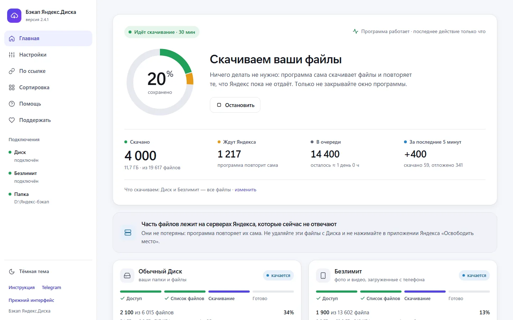
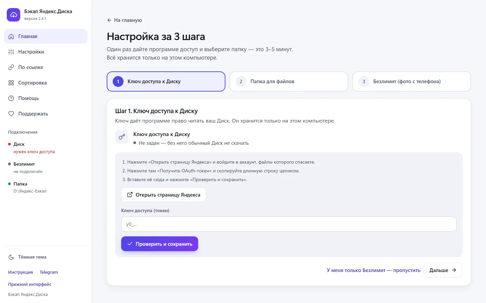
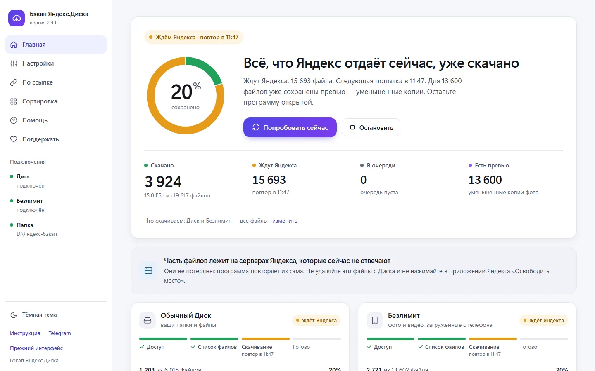
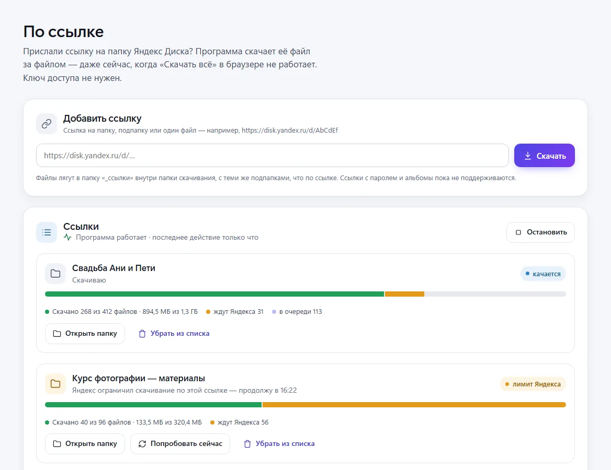
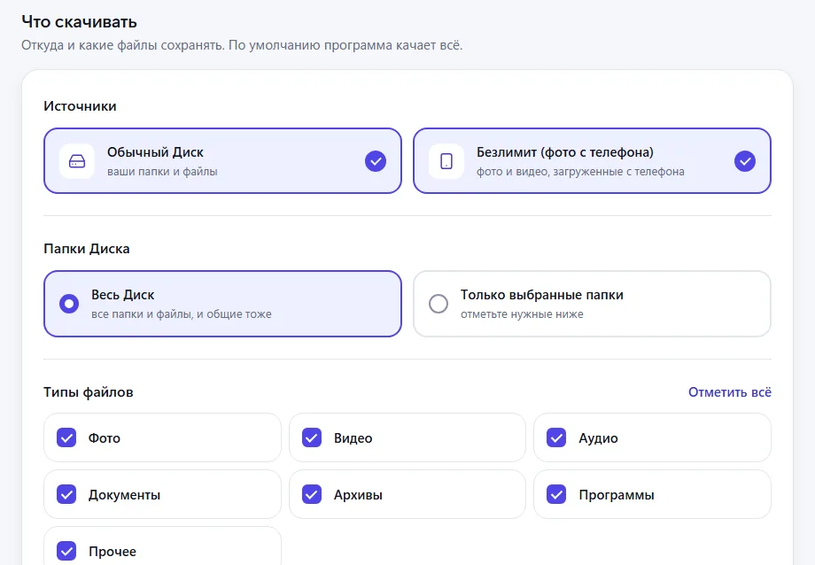
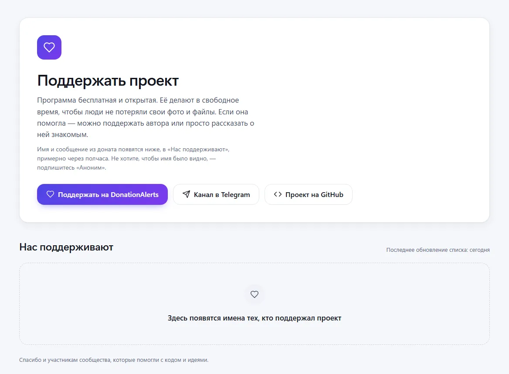

<div align="center">

# Бэкап Яндекс.Диска

**Бесплатная программа, которая сохраняет на ваш компьютер весь Яндекс.Диск:<br>папки и документы, фото и видео из безлимита, папки по публичным ссылкам.**

Работает и сейчас, когда Яндекс отдаёт файлы с перебоями: скачивает всё, что доступно,<br>а остальное повторяет сама, пока не заберёт.

[](https://github.com/PXSYS13/yadisk_backup/archive/refs/heads/main.zip)
[](https://github.com/PXSYS13/yadisk_backup/blob/main/INSTRUCTION_GET_TOKEN.md)
[](https://www.donationalerts.com/r/davronsvv)

[](https://github.com/PXSYS13/yadisk_backup/releases/latest)

[](https://t.me/davronsv)
[](https://www.youtube.com/watch?v=XAiJxqHkEUA)


</div>

<picture>
  <source media="(prefers-color-scheme: dark)" srcset="docs/images/home-dark.webp">
  
</picture>

## Что сейчас происходит с Яндекс.Диском

В октябре 2026 года Яндекс отключил скачивание архивами, а часть серверов, где лежат файлы, перестала отвечать — и программам, и веб-версии, и официальному API. **Файлы при этом не удалены**: они временно недоступны.

Программа это учитывает:

- скачивает всё, что Яндекс отдаёт прямо сейчас — обычный Диск и безлимит одновременно;
- файлы с молчащих серверов откладывает и **сама пробует снова каждые 30 минут**, пока программа открыта;
- для фото, чей оригинал пока недоступен, сохраняет уменьшенную копию (до 1280 пикселей) — чтобы у вас уже сейчас что-то было. Оригинал докачается сам, и копия удалится;
- проверяет каждый скачанный файл по размеру и контрольной сумме.

**Что делать вам:** запустить программу, нажать «Сохранить мои файлы», оставить компьютер включённым. И пока всё не скачано — **ничего не удалять с Диска** и не нажимать «Освободить место» в приложении Яндекса.

## Что умеет

- **Весь Диск или только нужные папки.** Папки на компьютере — такие же, как на Диске. Общие папки, к которым вам дали доступ, тоже скачиваются.
- **Безлимит — фото и видео с телефона.** Яндекс прячет их отдельно от обычных файлов; программа достаёт их по одному.
- **Папки и альбомы по публичной ссылке** (`disk.yandex.ru/d/…`, `disk.yandex.ru/a/…`) — без ключа доступа, даже когда кнопка «Скачать всё» на сайте не работает. Из альбомов скачиваются оригиналы по одному.
- **Продолжает с того же места.** Закрыли программу, выключили компьютер — при следующем запуске скачанное второй раз не качается.
- **Можно качать на внешний диск** и переносить уже скачанное, чтобы освободить место: программа помнит, что скачала, и показывает, какие папки скачаны целиком.
- **Понятный экран.** Сразу видно, что программа работает, сколько сохранено, сколько ждёт Яндекса и что нужно сделать вам.
- **Бережный режим** для медленного интернета и страховочные уменьшенные копии фото — включаются в настройках.
- **Сортировка по типам — по желанию.** Может разложить скачанное по папкам «Фото», «Видео», «Документы» (фото и видео — по годам) и найти одинаковые файлы.
- **Не даёт компьютеру уснуть**, пока идёт скачивание (Windows и macOS).
- **Всё хранится только у вас.** Пароль от Яндекса программе не нужен, ключи доступа не уходят дальше вашего компьютера.

## Как начать

Настройка займёт 10–15 минут, дальше программа качает сама. Ставить Python или что-то ещё вручную не нужно.

1. **Скачайте** [программу (ZIP-архив)](https://github.com/PXSYS13/yadisk_backup/archive/refs/heads/main.zip) и распакуйте: правой кнопкой по архиву → «Извлечь всё».
2. **Запустите:**
   - Windows — двойной клик по `webui.bat`. Если Windows покажет «Windows защитил ваш компьютер» — «Подробнее» → «Выполнить в любом случае»;
   - macOS — двойной клик по `webui.command`;
   - Linux — `bash webui.sh` в папке программы.

   В первый раз программа 1–2 минуты скачивает всё нужное, потом сама открывает страницу в браузере. Если не открыла — наберите в браузере адрес из строки «Адрес» в окне программы, обычно `localhost:8000`.
3. **Пройдите «Настройку за 3 шага»:** ключ доступа к Диску (кнопка ведёт на страницу Яндекса, где его выдают), папка для файлов, доступ к безлимиту (можно пропустить).
4. **Нажмите «Сохранить мои файлы»** и не закрывайте чёрное окно программы — пока оно открыто, программа работает.

Каждый шаг с подсказками, что нажимать и что делать, если что-то пошло не так, — в [пошаговой инструкции](https://github.com/PXSYS13/yadisk_backup/blob/main/INSTRUCTION_GET_TOKEN.md). Видеоразбор — [на YouTube](https://www.youtube.com/watch?v=XAiJxqHkEUA).

<p align="center"></p>

## Как это выглядит

<table>
<tr>
<td width="50%"></td>
<td width="50%"></td>
</tr>
<tr>
<td><b>Яндекс отдал не всё?</b> Программа покажет, сколько файлов ждут его серверов и когда следующая попытка. Кнопка «Попробовать сейчас» — чтобы не ждать.</td>
<td><b>По ссылке.</b> Вставьте ссылку на чужую папку — программа скачает её файл за файлом, со всеми подпапками.</td>
</tr>
<tr>
<td></td>
<td></td>
</tr>
<tr>
<td><b>Что скачивать.</b> Весь Диск или выбранные папки, безлимит, типы файлов. По умолчанию — всё.</td>
<td><b>Нас поддерживают.</b> Имена тех, кто поддержал проект, программа показывает сама.</td>
</tr>
</table>

## Частые вопросы

<details>
<summary><b>Это бесплатно? Это безопасно?</b></summary>

Программа бесплатная, с открытым кодом (лицензия MIT). Её можно проверить: весь код — в этом репозитории.

- Пароль от Яндекса не нужен. Программа работает по ключу доступа, который выдаёт сам Яндекс, а для безлимита — по данным входа из вашего браузера.
- Ключ и данные входа хранятся только на вашем компьютере (файлы `.env` и `cookies.json`) и никуда не отправляются.
- Страница `localhost:8000` — это пульт управления на вашем компьютере. Из интернета она недоступна, чужие сайты не могут ею управлять.
- Кроме Яндекса программа обращается только к GitHub: раз в 15 минут берёт список «Нас поддерживают» и раз в 6 часов проверяет, не вышла ли новая версия. О вас она ничего не отправляет, а новую версию только предлагает — сама ничего не устанавливает.
- Не передавайте ключ доступа и данные входа другим людям: с ними можно скачать ваши файлы.

Программа неофициальная и не связана с Яндексом. Скачивание безлимита через данные входа из браузера Яндекс официально не описывает — используйте программу только для своих файлов.
</details>

<details>
<summary><b>Часть файлов «ждут Яндекса». Они пропали?</b></summary>

Нет. Каждый файл хранится на конкретном сервере Яндекса, и часть серверов сейчас молчит. Программа замечает это за 10 секунд, откладывает такие файлы и качает остальные. Каждые 30 минут она пробует отложенные снова — как только сервер оживёт, файлы скачаются сами. Не удаляйте эти файлы с Диска.
</details>

<details>
<summary><b>Сначала качалось быстро, а теперь почти ничего не скачивается. Это у всех так?</b></summary>

Так бывает у всех, и это не поломка. Программа пробует каждый файл по очереди: файлы с работающих серверов Яндекса скачиваются сразу, а файлы с молчащих откладываются. Поэтому сначала скачивается много. Когда живые файлы кончаются, в очереди остаются только файлы молчащих серверов, и почти все новые попытки неудачные. Доля удачных скачиваний падает, хотя Яндекс хуже не стал.

Каждые 30 минут программа пробует отложенные файлы снова. После каждой попытки в ленте «Что происходит» появляется строка «Из N файлов, ждавших Яндекса, скачано M». Если это число растёт от попытки к попытке, Яндекс возвращает серверы. Оставьте программу открытой, и она докачает остальное сама.

В командной строке `uv run main.py stats` показывает, сколько файлов программа ещё не пробовала, а сколько ждут Яндекса. Если не пробовала ни одного, значит, всё, что Яндекс отдаёт сейчас, уже скачано. Повторять отложенные сама командная строка начинает только с ключом `--wait`.
</details>

<details>
<summary><b>Сколько времени займёт скачивание?</b></summary>

Файлы с работающих серверов скачиваются так быстро, как позволяет ваш интернет: 1 ТБ через интернет 100 Мбит/с — это минимум сутки без перерыва, 3 ТБ — минимум трое суток. Поэтому большой Диск удобно оставить на ночь: ночью серверы Яндекса загружены меньше. Файлы, которые ждут Яндекса, не качаются медленно, а ждут, пока Яндекс их отдаст, — программа повторяет их сама каждые 30 минут.

Скорость видна на главном экране в карточке Диска или Безлимита, пока идёт скачивание. Программа пишет её в мегабайтах в секунду, а в скобках — в мегабитах, как у провайдера и Speedtest (1 МБ/с — это примерно 8 Мбит/с). Пока программа качает, она делит интернет с остальными, поэтому Speedtest в это время покажет меньше, чем по тарифу. Чтобы измерить сам интернет, нажмите «Остановить», сделайте замер и нажмите «Продолжить» — скачанное сохранится. Если из-за скачивания дома тормозит интернет, включите «Настройки» → «Дополнительно» → «Бережный режим».

Не закрывайте крышку ноутбука: программа не даёт компьютеру уснуть, но закрытая крышка всё равно его усыпит.
</details>

<details>
<summary><b>Можно узнать, что всё скачалось, не заглядывая в программу?</b></summary>

Да, с версии 2.8. Откройте «Настройки» → «Дополнительно», включите «Сообщать, когда всё скачается или понадобится ваше действие» и разрешите уведомления, когда браузер спросит. Браузер сообщит, когда всё скачается, когда всё доступное уже скачано и остальное ждёт Яндекса, и когда программе нужно ваше действие: новый ключ, доступ к безлимиту или место на диске. Нажмите на уведомление — откроется программа.

Вкладку с программой не закрывайте, свернуть её можно. Даже без уведомлений видно по названию вкладки: «● Нужно действие» или «✓ Готово». Если пробное уведомление не появилось, проверьте, не включён ли в Windows режим «Не беспокоить» и разрешены ли там уведомления для браузера. Если браузер «усыпляет» неактивные вкладки, добавьте адрес программы в список сайтов, которые всегда остаются активными: в Chrome и Edge он в настройках производительности.
</details>

<details>
<summary><b>Где будут мои файлы и в каких папках?</b></summary>

В папке, которую вы выбрали при настройке (по умолчанию — `downloads` внутри папки программы). Обычный Диск — с теми же папками, что на Яндекс.Диске: `Загрузки/Проект/Отчёт.docx` ляжет в `<ваша папка>\Загрузки\Проект\Отчёт.docx`. Фото из безлимита — в подпапку `_unlim`, папки по ссылкам — в `_ссылки`.

Знаки, которые Windows не разрешает в именах (`: ? * " < > |`), заменяются на `_`. Если пришлось исправить имя файла или два файла получили бы одно имя, в конце имени появится короткий хвост вида `_a1b2c3`.
</details>

<details>
<summary><b>Как проверить, что всё скачалось целиком и без ошибок?</b></summary>

На главной у Обычного Диска или Безлимита нажмите «Подробнее», а там — «Проверить скачанные файлы». Программа сверит каждый скачанный файл с Яндексом: на месте ли он, совпадают ли размер и контрольная сумма (MD5). Проверять можно, когда скачивание остановлено или закончено. Большая папка проверяется долго — программа читает каждый файл целиком, сотни гигабайт занимают час и больше. Проверку можно остановить и запустить позже.

В конце программа напишет «Проверено N — всё в порядке» или сколько файлов не хватает и сколько повреждено. Если вы сами перенесли или удалили часть файлов, программа покажет их как недостающие — это нормально. Пропавшие и испорченные файлы кнопка «Скачать заново» вернёт в очередь: они скачаются, когда вы нажмёте «Продолжить» на главной.
</details>

<details>
<summary><b>Места на компьютере не хватит. Можно скачивать на внешний диск?</b></summary>

Да. «Настройки» → «Папка для файлов» → «Сменить папку» и укажите папку на внешнем диске, например `E:\Яндекс Диск`. Корень диска (`E:\`) выбрать нельзя, а папку программа создаст сама. Если скачивание уже идёт, сначала остановите его.

Уже скачанное останется в старой папке и второй раз качаться не будет, остальное докачается в новую. Если программа заранее видит, что место кончится, она предупредит на главном экране. Если место всё-таки кончилось, она остановится и попросит выбрать другую папку.

Внешний диск держите подключённым. Если его отключить, программа встанет на паузу. Подключите диск и нажмите «Попробовать снова». Диск в формате FAT32 (так бывает у флешек) не примет файлы больше 4 ГБ — программа предупредит об этом в «Настройках». Для больших видео нужен NTFS или exFAT.
</details>

<details>
<summary><b>Можно скачать два аккаунта — свой и жены — в разные папки?</b></summary>

Да. Распакуйте программу второй раз в отдельную папку, например `Бэкап жены`, и запустите её так же, как первую. У каждой копии свои ключ доступа, данные входа в безлимит, папка для файлов и прогресс, поэтому копии не мешают друг другу и могут качать одновременно на одном компьютере. Вторая копия сама откроется по соседнему адресу — `localhost:8001`, а слева в каждой вкладке видно, чей Диск подключён.

- Ключ для второго аккаунта получайте, войдя на yandex.ru именно в него. Данные входа для безлимита копируйте из браузера, где открыт этот аккаунт: удобно завести для него отдельный профиль браузера.
- Не выбирайте обеим копиям одну и ту же папку для файлов — иначе файлы двух аккаунтов перемешаются.
- Интернет копии делят между собой.

До версии 2.7.3 вторая копия не запускалась, пока работает первая: обновите обе копии.
</details>

<details>
<summary><b>Можно перенести скачанное на другой диск, чтобы освободить место?</b></summary>

Да. Программа помнит, что уже скачала, по своему списку, а не по содержимому папки. Перенесённые файлы она заново не качает — ни при повторах, ни после «Обновить список».

- Переносите папки, которые скачаны целиком: их видно на главном экране («Скачаны целиком: N из M папок») и в «Подробнее» у Диска. Когда папка докачается, в ленте «Что происходит» появится «Папка «…» скачана целиком».
- Папку, которая ещё качается, лучше не трогать: недокачанные файлы лягут в её старое место, и папка окажется в двух местах.
- Папку «_превью» не переносите — программа сама убирает из неё копии, когда докачивает оригиналы.
- После переноса не нажимайте «Забыть список файлов»: тогда программа узнаёт скачанное только по папке и скачает перенесённое снова.
- Файл, который изменили на Диске, программа скачает ещё раз — это новая версия.
- Фото и видео из безлимита (папка `_unlim`) переносите по тем же правилам.
</details>

<details>
<summary><b>Можно выключить компьютер и продолжить завтра?</b></summary>

Да. Программа помнит каждый файл: уже скачанное второй раз качаться не будет. Запустите её снова — с версии 2.8 скачивание продолжится само, с того же места, если вы не нажимали «Остановить». Чтобы после запуска программа ждала вашей команды, выключите «Настройки» → «Дополнительно» → «Продолжать скачивание после перезапуска».
</details>

<details>
<summary><b>После обновления программа качает всё заново</b></summary>

Так бывает, если новую версию распаковали не поверх старой, а в другую папку: у новой копии нет ваших настроек и прогресса, и она качает в свою папку `downloads`. Закройте её чёрное окно и распакуйте архив поверх старой папки программы. Если новая копия уже работает, укажите ей в «Настройках» → «Папка для файлов» прежнюю папку со скачанным: файлы, которые там уже лежат с тем же размером и содержимым, программа второй раз не скачает, а только сверит. Сверка тысяч файлов занимает время — это не повторное скачивание.
</details>

<details>
<summary><b>Что за папка «_превью»?</b></summary>

Пока оригинал фото недоступен, программа сохраняет его уменьшенную копию — до 1280 пикселей. Это страховка на случай, если оригинал так и не вернётся. Когда оригинал скачается, он ляжет на своё место в полном качестве, а копия удалится сама. Отключить: «Настройки» → «Дополнительно» → «Сохранять уменьшенные копии фото, пока оригинал недоступен».

Если некоторые фото маленькие (40–300 КБ) и в плохом качестве, скорее всего, это и есть такие копии. Папка `_превью` повторяет папки Диска, поэтому по ней видно, у каких фото оригинала пока нет.
</details>

<details>
<summary><b>Что делает «Сортировка»?</b></summary>

Обычно она не нужна: файлы уже лежат в тех же папках, что на Диске. Вкладка «Сортировка» по вашей кнопке собирает файлы из всех папок в общие: «Фото» и «Видео» (по годам и месяцам), «Документы», «Архивы», «Аудио», «Программы», «Прочее». Одинаковые файлы уезжают в `_duplicates`.

> [!WARNING]
> Папки, как на Диске, при этом исчезают, а опустевшие папки удаляются. Сами файлы не удаляются, но вернуть прежнее расположение автоматически нельзя. Сначала нажмите «Посмотреть, что получится» — программа покажет, сколько папок исчезнет и куда переедут файлы.
</details>

<details>
<summary><b>Программа просит новый ключ или доступ к безлимиту</b></summary>

Ключ доступа к Диску действует около года, данные входа для безлимита — от нескольких дней до нескольких недель. Когда они устареют, на главном экране появится сообщение с кнопкой «Получить новый ключ» или «Обновить доступ». Повторите шаг из инструкции — скачанное не пропадёт.
</details>

<details>
<summary><b>Ошибки 500, 502, 503, 429, «Яндекс отвечает медленно»</b></summary>

Это перебои на стороне Яндекса, а не ошибка программы. Программа сама делает паузы и повторяет запросы — её можно оставить работать. Если Яндекс просит обращаться реже, включите «Бережный режим» («Настройки» → «Дополнительно»). Новости о состоянии серверов — в [Telegram-канале](https://t.me/davronsv).
</details>

<details>
<summary><b>Как обновить программу?</b></summary>

С версии 2.7.2 программа сама пишет на главном экране «Вышла версия …», когда на GitHub появляется новая.

Скачайте [архив](https://github.com/PXSYS13/yadisk_backup/archive/refs/heads/main.zip) заново, закройте чёрное окно программы и распакуйте архив поверх старой папки, согласившись заменить файлы. Потом запустите программу как обычно. Ключ, данные входа, папка и прогресс скачивания сохранятся: их нет в архиве.
</details>

<details>
<summary><b>После обновления программа долго получает список файлов, или файлов стало больше</b></summary>

Список файлов программа помнит и сама обновляет его раз в 6 часов. С версии 2.7.4 она сначала докачивает по уже собранному списку, а потом обновляет его, поэтому скачивание этого не ждёт. Большой Диск Яндекс перечисляет долго: сотни тысяч файлов — до часа. Счётчик «уже найдено» на главном экране показывает, что сбор идёт. Если на Диск только что добавили файлы, нажмите «Обновить список» в карточке Диска или Безлимита — тогда список соберётся сразу.

Если файлов стало больше: прежний интерфейс (до версии 2.7.1) умел качать только часть типов файлов, например только фото. Теперь программа качает то, что отмечено в «Настройках» → «Что скачивать» → «Типы файлов», а там по умолчанию отмечено всё. Об этом есть строка в ленте «Что происходит». Ненужные типы снимите в «Настройках». Уже скачанное второй раз качаться не будет.
</details>

<details>
<summary><b>Пишет «address already in use» или на localhost:8000 открывается страница принтера</b></summary>

Адрес `localhost:8000` уже занят другой программой. В Ubuntu и других Linux так бывает со службой печати `ghostscript-printer-app`. С версии 2.6.1 программа сама берёт следующий свободный адрес — `localhost:8001`, `8002` и так далее — и пишет его в окне в строке «Адрес». Если программа из этой же папки уже запущена в другом окне, повторный запуск просто откроет её в браузере, а копия из другой папки (например, для второго аккаунта) запустится рядом, на следующем адресе.

В версиях до 2.6.1 запустите программу так, а потом откройте в браузере `localhost:8001`:

```bash
YADISK_PORT=8001 bash webui.sh
```

В Linux в чёрном окне бывают строки с `ERROR`, `zygote` или `Gtk` — это сообщения браузера, который программа открыла, а не ошибки программы. Если страница программы не открылась, откройте в браузере адрес из строки «Адрес» в начале окна.
</details>

<details>
<summary><b>Что-то не работает — как попросить помощи?</b></summary>

Вкладка «Помощь» → «Скачать отчёт для поддержки». В отчёте журналы программы и её состояние, но нет ключа и данных входа. Пришлите его в [Telegram](https://t.me/davronsv) или приложите к [вопросу на GitHub](https://github.com/PXSYS13/yadisk_backup/issues/new).

Чёрное окно сразу закрылось или пишет «Could not install uv automatically» — проверьте интернет и запустите снова. Не помогло — установите uv [по инструкции](https://docs.astral.sh/uv/getting-started/installation/), закройте все чёрные окна и запустите `webui.bat` ещё раз.

Пишет «does not match the expected checksum» — установщик uv скачался не тот, что ожидает программа (оборвалась загрузка или его подменили по пути), и программа его не запустила. Запустите `webui.bat` позже или установите uv по той же инструкции.
</details>

## Поддержать проект

Программу делает один человек в свободное время, чтобы люди не потеряли свои фото и документы. Она бесплатная и такой останется. Если она помогла вам — поддержите её развитие любой суммой:

<p align="center">
  <a href="https://www.donationalerts.com/r/davronsvv"></a>
</p>

**Ваше имя появится в программе.** Имя и сообщение из доната попадают в раздел «Нас поддерживают» у всех пользователей программы. Не хотите, чтобы имя было видно, — подпишитесь «Аноним». Ссылки и упоминания из сообщений программа не показывает.

Помочь можно и без денег: поставьте звезду этому репозиторию, расскажите о программе тем, кто хранит фото на Яндекс.Диске, или сообщите об ошибке.

## Сообщество

- [Telegram-канал @davronsv](https://t.me/davronsv) — новости, состояние серверов Яндекса, ответы на вопросы.
- [Видеоинструкция на YouTube](https://www.youtube.com/watch?v=XAiJxqHkEUA).
- [Вопросы и ошибки на GitHub](https://github.com/PXSYS13/yadisk_backup/issues) и [обсуждения](https://github.com/PXSYS13/yadisk_backup/discussions).

Спасибо участникам, которые помогли кодом и идеями: идея страховочных превью — из форка [woohung](https://github.com/woohung/yadisk_backup), исправления — от [CyberPunk10](https://github.com/CyberPunk10), а скачивание безлимита по одному файлу подсказали в сообществе.

## Для продвинутых

<details>
<summary><b>Командная строка вместо веб-интерфейса</b></summary>

Если uv уже установлен:

```bash
git clone https://github.com/PXSYS13/yadisk_backup.git
cd yadisk_backup
uv run webui.py
```

Те же действия без интерфейса:

```bash
# Обычный Диск (ключ — в .env, YA_DISK_TOKEN)
uv run main.py check                                   # проверить ключ
uv run main.py scan                                    # собрать список файлов
uv run main.py scan --root /Фото --root "/Работа/2024" # только эти папки
uv run main.py download --workers 4                    # скачать
uv run main.py download --wait                         # скачать и повторять отложенное каждые 30 минут
uv run main.py retry-failed                            # вернуть в очередь то, что не скачалось
uv run main.py verify                                  # все ли скачанные файлы на месте: размер и MD5
uv run main.py stats                                   # статистика: скачано, ждут Яндекса, ещё не пробовали

# Безлимит (нужен cookies.json)
uv run unlim_download.py --collect                     # собрать список
uv run unlim_worker.py --id 1                          # скачивать (можно несколько с разными --id)
uv run unlim_worker.py --id 1 --wait                   # то же, отложенное повторять каждые 30 минут
uv run unlim_download.py --status                      # что в очереди
uv run unlim_download.py --retry-failed                # вернуть в очередь то, что не скачалось
uv run unlim_download.py --verify                      # проверить скачанное из безлимита

# По публичной ссылке (ключ не нужен)
uv run public_download.py --add https://disk.yandex.ru/d/XXXX
uv run public_download.py --wait                       # скачать, отложенное повторять
uv run public_download.py --status

# Сортировка по типам (папки, как на Диске, исчезнут)
uv run organize.py --input "D:/Backup"                 # отчёт: что куда переедет
uv run organize.py --input "D:/Backup" --action move   # переложить
```

Коды выхода: `0` готово, `1` часть файлов не скачалась, `2` ключ или данные входа не подходят, `3` Яндекс недоступен — повторить позже, `4` нет места или нет доступа к папке, `5` скачано всё доступное, остальное ждёт серверов Яндекса.

Без `--wait` командная строка проходит очередь один раз и выходит с кодом `5`, если часть файлов ждёт Яндекса: повторять их нужно самому. Веб-интерфейс и ключ `--wait` повторяют их сами каждые 30 минут (`YADISK_RETRY_EVERY_SEC` меняет интервал, но не чаще раза в минуту).
</details>

Как устроен проект, как запускать тесты и присылать изменения — в [руководстве для разработчиков](CONTRIBUTING.md).

## Лицензия

[MIT](LICENSE). Программа распространяется «как есть», без гарантий. Автор — Davron, 2026.
